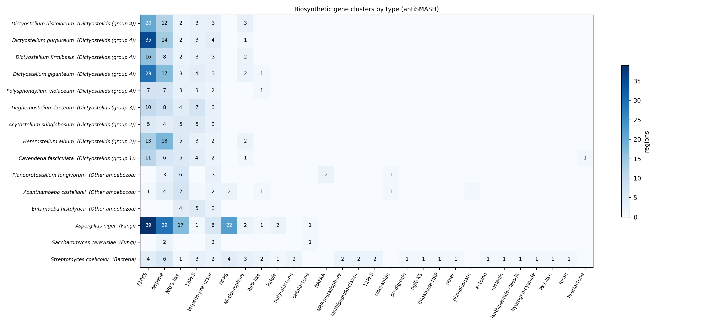

# Slime mold genome mining

**Do social amoebae (dictyostelid slime molds) carry a hidden toolkit for making natural products?** This project scans their genomes for biosynthetic gene clusters (BGCs), the groups of genes that build antibiotics, pigments and other specialized molecules, and compares them with other amoebae, two fungi and a *Streptomyces* bacterium.

It started from a question in a community college project: are slime molds like fungi? Comparing one protein can't answer that. Comparing what whole genomes are equipped to *make* is a better question, and it bears on drug discovery: slime molds are far less explored than fungi or bacteria.

## First results (15 genomes)



| Group | Type I PKS clusters | All BGC regions |
|---|---:|---:|
| Dictyostelids (9 species) | 5-35 (median 13) | 19-57 |
| Other amoebae (3 species) | 0-1 | 12-18 |
| *Aspergillus niger* (fungus) | 39 | 91 |
| *Saccharomyces cerevisiae* (yeast) | 0 | 5 |
| *Streptomyces coelicolor* (bacterium) | 4 | 31 |

- **Polyketide synthases are the slime molds' specialty.** Every dictyostelid has 5 to 35 type I PKS clusters, while their non-social amoeba relatives have at most one. *D. purpureum* (35) comes close to *Aspergillus niger* (39), a fungus known for its rich chemistry.
- **The expansion is strongest in group 4** (*Dictyostelium*: 16-35), the most recently diverged lineage, and smaller in groups 1-3 (5-13). That suggests these genes multiplied after social amoebae arose.
- **Every dictyostelid has 1-4 hybrid regions with both type I and type III PKS**, consistent with the "Steely" enzymes known from *D. discoideum*, where both kinds of PKS are fused into one protein. No other genome here has them.
- **No true NRPS clusters in any dictyostelid** (only NRPS-like fragments), unlike *Aspergillus* (22). Their chemistry is polyketide- and terpene-based, not peptide-based.
- Terpene clusters are also common (4-18 per dictyostelid).

## Caveats

- antiSMASH has no amoeba mode; eukaryotes run with `--taxon fungi`, so the detection rules were built on fungal genes. Counts are best read as relative, not exact.
- Results depend on each genome's gene annotation, which comes from different groups and methods. Two malformed genes in the *Acanthamoeba* annotation (overlapping exons) were removed so antiSMASH would run (see `logs/clean/`).
- Plasmodial slime molds (*Physarum*, *Badhamia*) have no annotated genome on NCBI yet, so they aren't included.
- A cluster means the genes are there, not that the molecule is made. Many clusters are silent in lab conditions.

## Next steps

- Group similar clusters across species (BiG-SCAPE) to find which are shared by all dictyostelids and which are unique to one species.
- Build a PKS domain tree to test whether the expansion happened by gene duplication within the lineage.
- Annotate *Physarum* (e.g. with BRAKER) and add it.

## Running it

Runs on Linux or WSL with conda:

```bash
conda create -n bgc -c conda-forge -c bioconda antismash ncbi-datasets-cli "snakemake-minimal>=8" matplotlib
conda activate bgc
download-antismash-databases
snakemake --cores 16
```

Genomes are listed in `config/genomes.tsv`. The workflow downloads each annotated genome from NCBI, removes malformed gene models (`workflow/scripts/clean_gbff.py`), runs antiSMASH 8, and summarizes the regions (`results/bgc_counts.tsv`, `results/bgc_regions.tsv`, `results/bgc_heatmap.png`). The full run takes about 25 minutes on 16 cores.
